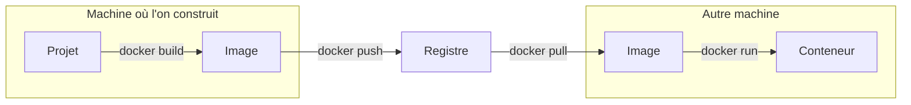

Une image sert surtout quand elle quitte la machine où elle a été construite. Ce cours vous fait suivre tout le trajet : trouver une image, lancer votre propre registre, y publier la vôtre, la récupérer comme le ferait une autre machine, et retrouver une ancienne version quand un tag a bougé.

**Prérequis** : savoir lancer un conteneur et écrire un petit Dockerfile, ce qu'enseignent [Lancer, configurer et observer un conteneur](https://byte-layers.com/fr/skills/docker-run) et [Écrire le Dockerfile d'une application](https://byte-layers.com/fr/skills/docker-dockerfile). Les mots registre, dépôt, tag et digest sont expliqués dans [Nommer une image : registre, tag, digest](https://byte-layers.com/fr/bits/image-reference), à lire avant.

## Le trajet d'une image, d'une machine à l'autre

Vous savez déjà aller d'un projet à une image, puis à un conteneur, sur votre machine. Ce cours ajoute le chemin vers une autre machine : `docker push` envoie l'image dans un registre, et `docker pull` l'en télécharge ailleurs.

## Ce qu'il vous faut

> ⚠️ **Si un téléchargement échoue avec `429 Too Many Requests`** : Docker Hub limite les téléchargements anonymes par adresse IP, et une salle entière partage souvent la même. Attendez, ou créez un compte gratuit sur Docker Hub et lancez `docker login`.

Il vous faut Docker qui répond à `docker ps`, `curl`, et le port **28340** libre. Aucun compte n'est nécessaire pour suivre le cours, en dehors du cas ci-dessus : le registre dans lequel vous publiez est un conteneur local, et rien ne sort de votre machine.

## Comment ça se passe

Le cours compte cinq étapes à suivre dans l'ordre, pour environ 1 h 15 en tout. Les étapes 2 à 5 s'enchaînent, car le registre n'est supprimé qu'à la fin. Vous connaissez maintenant `docker run` et `docker build` : ces commandes ne sont plus détaillées, et le texte se concentre sur ce qui est nouveau.

Tout ce que vous créez porte le préfixe `layers-l4-`, et vos fichiers vont dans `~/layers-l4`. La dernière étape supprime le tout.

Pour vous tester ensuite sans guide, faites le challenge [Publier une image et la retrouver par son digest](https://byte-layers.com/fr/challenges/docker-publish-challenge).
